# Code Flow Reference

This document traces the execution path of every major pipeline in the system. Each section uses a Mermaid diagram with butterfly-wing branching — decision nodes fan outward symmetrically and re-converge at a common continuation point, matching the natural branching shape of the analysis pipelines.

---

## 1. Application Startup and Dashboard Lifecycle

When `streamlit run pulseengine/local/dashboard.py` is executed, Streamlit re-runs the entire script on every rerun triggered by user interaction or the 90-second auto-refresh. The singleton scan state is created exactly once per process using `@st.cache_resource`.

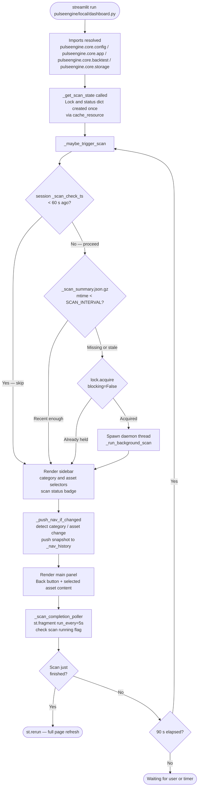

**Navigation history and back button:** On every rerun, `_push_nav_if_changed()` compares the current values of `_selected_category`, `_selected_asset`, and `_confirmed_custom_ticker` against the snapshot saved on the previous rerun. If any differ, the old snapshot is pushed onto `st.session_state["_nav_history"]` (capped at 20 entries). The **← Back** button is rendered fixed-positioned at the top-left of the main panel; clicking it pops the most recent snapshot via `_on_back_click()` and restores the previous page state through `_restore_nav_state()`. A `_nav_restoring` flag on the following rerun tells `_push_nav_if_changed()` to skip the push, preventing a spurious duplicate entry caused by the restore itself appearing as a navigation event.

**Startup auto-refresh:** `_scan_completion_poller` is a `@st.fragment(run_every=5)` component rendered after the main panel. It polls the shared scan-state dict every 5 seconds and calls `st.rerun()` once when `state["running"]` transitions from `True` to `False`. This replaces the old stale-data banner and manual refresh button with a fully automatic update the moment the background scan thread finishes.

---

## 2. Background Full-Market Scan

`_run_background_scan` (in `pulseengine/local/dashboard.py`) calls `pulseengine.local.scan.run_scan()`. The full batch pipeline lives in `pulseengine/local/scan.py`. News is fetched once and reused across all 24 assets. A `price_cache` (`{ticker: change_1d}`) is pre-built via `fetch_all_metrics_parallel` before the loop, eliminating redundant yfinance calls during context analysis. Each asset is analysed with `with_market_ctx=True` and `save=True`.

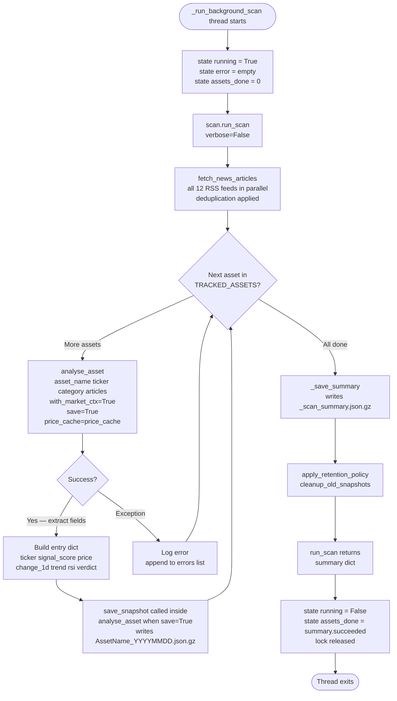

---

## 3. Price Data Pipeline

`fetch_price_history` retrieves raw OHLCV data. `compute_price_metrics` and `compute_momentum_metrics` derive all scalar indicators from the Close series.

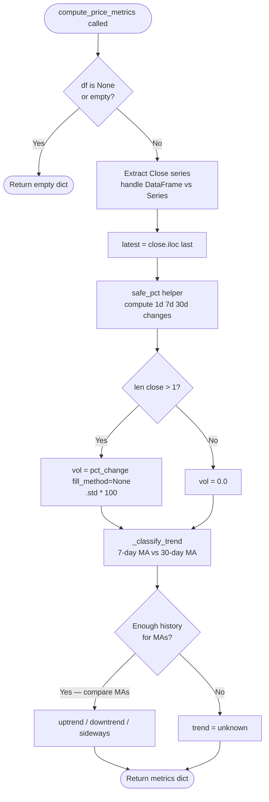

---

## 4. Momentum Metrics Pipeline

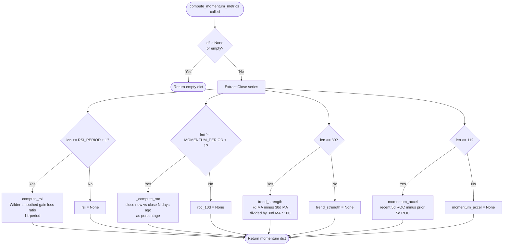

---

## 5. News Ingestion and Deduplication Pipeline

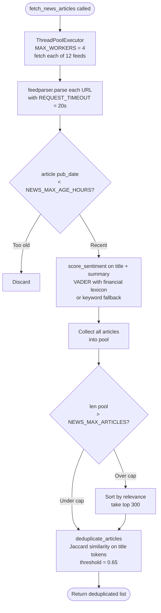

---

## 6. Keyword Generation Pipeline

`generate_keywords` is a utility in `pulseengine/core/news.py` that auto-builds a keyword list for any ticker using Yahoo Finance metadata. It is used by the dashboard when the user enters a custom ticker, and falls back gracefully on network failure or unknown symbols.

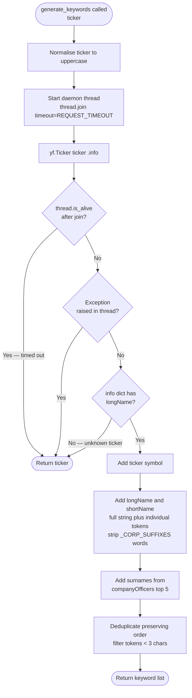

---

## 7. News Correlation Pipeline

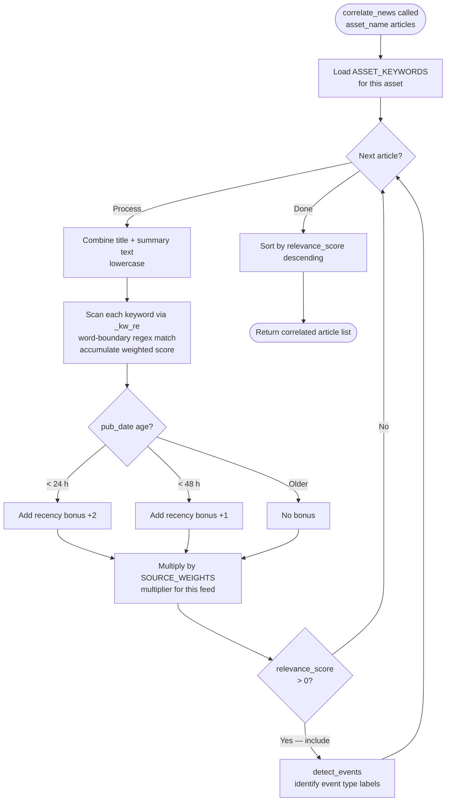

---

## 8. Signal Scoring Pipeline

Six components are computed from separate data sources, each multiplied by an asset-class-specific weight, then summed and clamped to the -10 to +10 range.

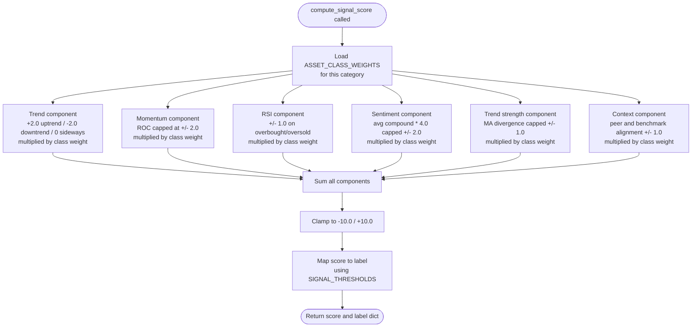

---

## 9. Market Context Analysis Pipeline

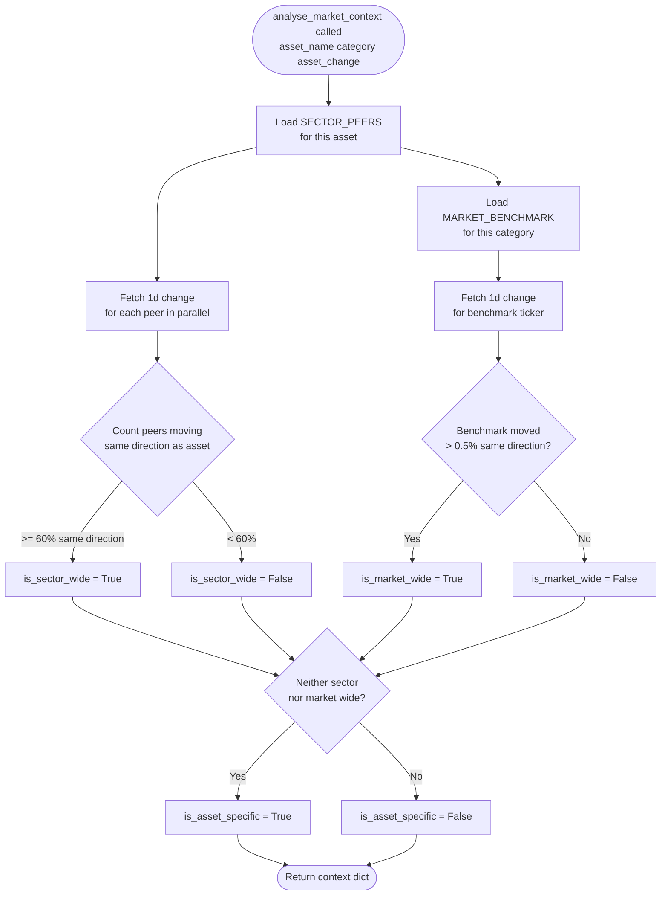

---

## 10. Explanation Builder Pipeline

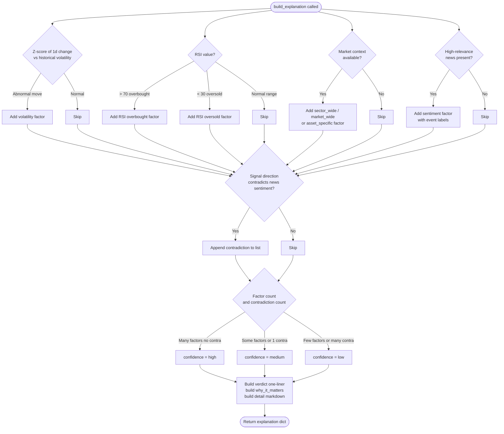

---

## 11. Storage Persistence Pipeline

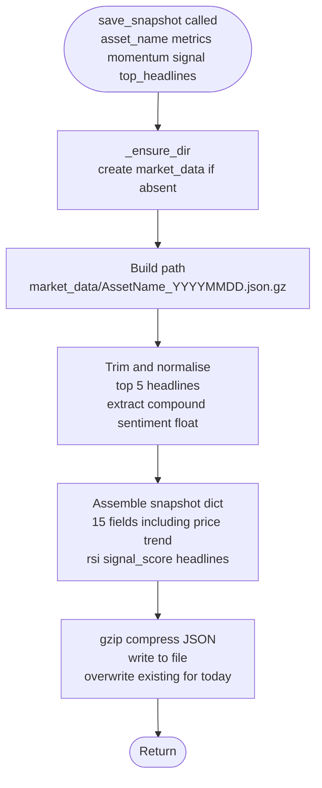

---

## 12. Retention Policy Pipeline

Run automatically at the end of each scan.

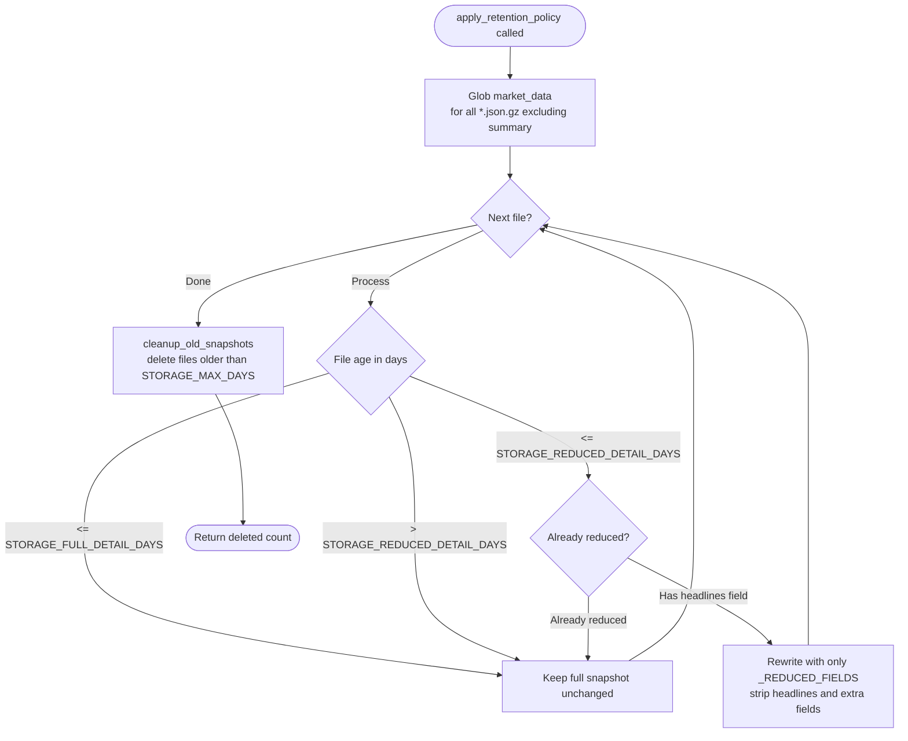

---

## 13. Backtesting Pipeline

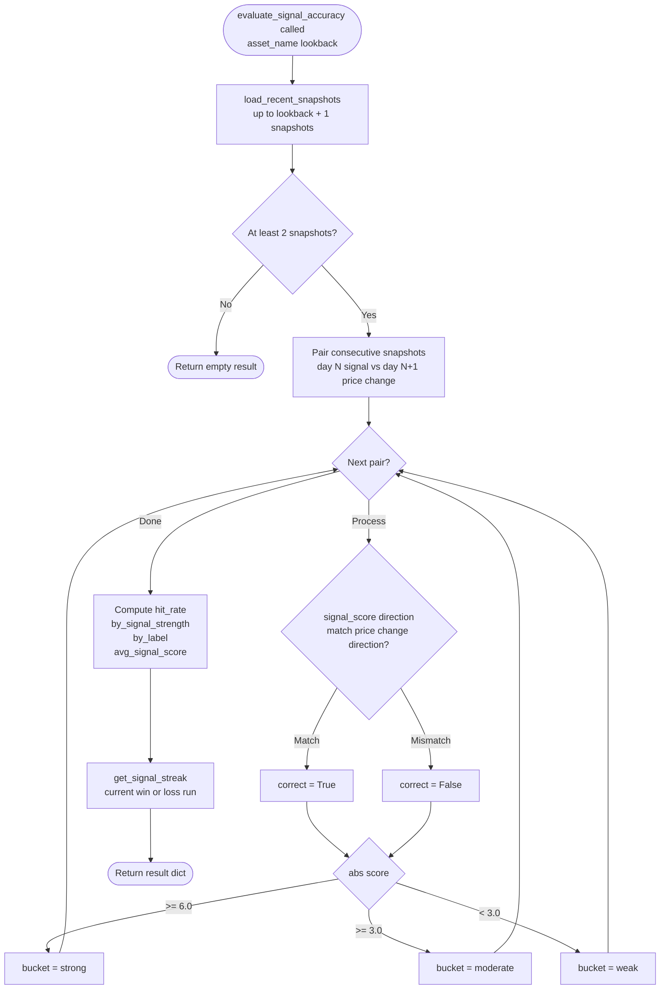

---

## 14. Full analyse_asset Orchestration

This is the top-level function called by both `pulseengine/local/scan.py` and directly by `pulseengine/local/dashboard.py`.

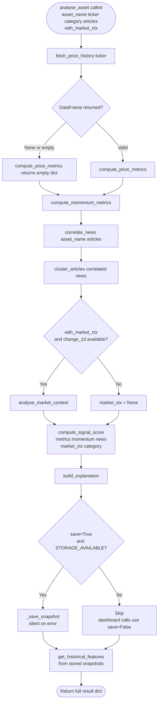

---

## 15. Parallel Metrics Pre-fetch Pipeline

Note: `fetch_all_metrics_parallel` is defined in `pulseengine/core/app.py`, but the dashboard does **not** call it directly. The market heatmap and category overview are populated from `cached_scan_summary()` in `pulseengine/local/data.py`, which reads the pre-computed `_scan_summary.json.gz` written by the scan pipeline. The diagram below shows `fetch_all_metrics_parallel` for reference — it is available for external use but bypassed by the current dashboard flow.

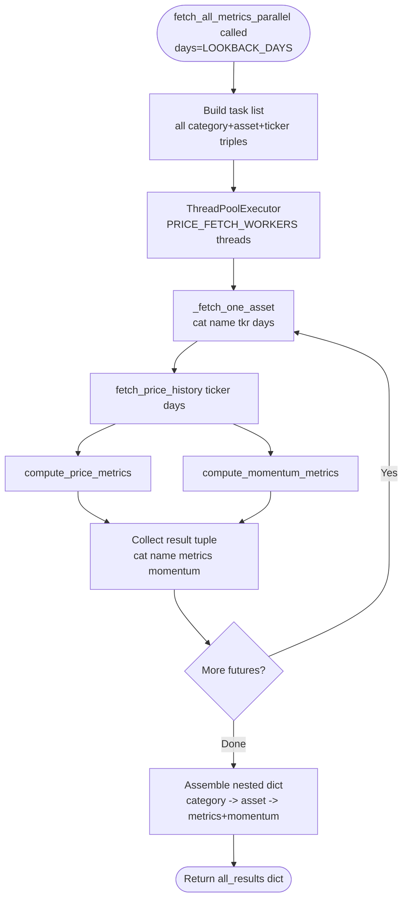

---

## 16. Local Installer Pipeline

`install.py` is the main installer. `install.sh` (macOS/Linux) and `install.ps1` (Windows) are thin wrappers that detect a compatible Python interpreter and then hand off to `install.py` via `exec` / `&`.

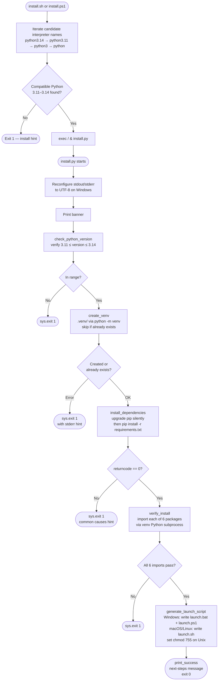
